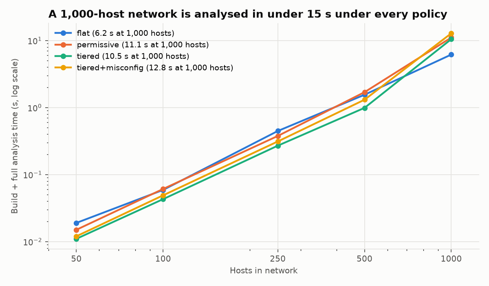

# Network Attack Path Mapper

**Graph-Based Analysis of Potential Attack Paths in Computer Networks**

The tool builds a directed reachability graph from a network's hosts, services, subnets and firewall rules. It reports which hosts can be reached from a chosen starting host, along which paths, and how a firewall change alters that. Status: **TRL 3**. In a 4-VM lab, the model's predictions matched 72 of 72 measured connections across two firewall policies (95% CI 95.0%–100%, section 8). Simulations of networks up to 1,000 hosts compare it with existing approaches (section 8A).

---

## 1. Problem statement

Defenders can't easily see how far an intrusion on one machine could spread. Reachability depends on several things at once: IP addressing, subnet boundaries, routing, the services each host exposes, and the order of firewall rules.

- **Rules are reviewed one at a time.** The combined effect of many first-match rules across subnets is hard to reason about by hand.
- **Segmentation is assumed, not measured.** Firewall changes are approved without a number for how much they reduce exposure.
- **Multi-hop exposure is invisible in rule lists.** A critical server blocked from the user LAN may still be reachable through a DMZ host.
- **Traffic inside a subnet bypasses the router firewall.**

**Research question:** given a network's hosts, services and firewall policy, which hosts are reachable from a starting point, along which paths, and how does a policy change alter that?

---

## 2. Technology concept

The network is modelled as a directed graph G = (V, E). Each vertex is a host. An edge u → v exists when at least one open service on v is reachable from u:

```text
(u, v) ∈ E  ⇔  ∃ s ∈ S(v) :  subnet(u) = subnet(v)  ∨  allow_F(u, v, s)
```

S(v) is the set of open services (port and protocol) on v. allow_F is the firewall decision under policy F.

**Model rules**

1. **Same subnet = same L2 segment.** Hosts in one subnet reach each other directly; the router firewall never sees that traffic.
2. **Between subnets, first match wins.** Rules are matched on source CIDR, destination CIDR, port and protocol. Unmatched traffic gets the default policy.
3. **Stateful.** Replies to permitted connections are allowed, so an edge records who can *start* a connection.
4. **Each edge keeps its services.** A path can be explained as "web via 80/tcp, then db via 5432/tcp".

**Analyses**

| Analysis | Graph method | What it tells a defender |
|---|---|---|
| Reachable hosts and hop count | BFS shortest paths | How far an intrusion could spread |
| Paths to critical hosts | Simple-path enumeration with a hop limit | Every route to important assets |
| Choke points | Immediate dominator tree | Hosts that every path to some other host must cross; the best places for monitoring and hardening |
| Key intermediate hosts | Betweenness centrality | Hosts on the most shortest paths |
| Policy comparison | Build the graph under two policies and diff them | The measured effect of a firewall change before it is deployed |

---

## 3. Tech stack

| Component | Technology |
|---|---|
| Language | Python 3 |
| Host and service discovery | Nmap (XML output) |
| IP/subnet handling | `ipaddress` |
| Graph analysis | NetworkX |
| Visualization | PyVis (interactive HTML) |
| Lab | VirtualBox, Ubuntu Server (router with iptables), Kali Linux |
| Tests | pytest |

---

## 4. Project structure

```text
network-attack-path-mapper/
├── collector/
│   ├── scanner.py          # runs nmap (private ranges only), collects routes
│   └── parser.py           # nmap XML -> network.json
├── analyzer/
│   ├── graph.py            # reachability graph + firewall first-match logic
│   └── paths.py            # hops, paths, choke points, centrality, compare
├── visualization/
│   └── visualize.py        # PyVis HTML with legend and highlighted paths
├── data/
│   ├── network.json        # sample 7-host, 3-subnet network + baseline policy
│   ├── firewall_segmented.json
│   └── lab.json            # model of the real 4-VM validation lab
├── lab/
│   ├── LAB_SETUP.md        # step-by-step VirtualBox lab guide
│   ├── create_lab_vms.ps1  # creates lab VM shells
│   ├── json_to_iptables.py # policy JSON -> iptables script (same file drives model + router)
│   ├── setup-server.sh     # one-shot setup for lab-web / lab-db
│   ├── measure.sh          # measures real TCP reachability from a VM
│   ├── compare_results.py  # model vs. measurements: accuracy, confusion matrix, 95% CI
│   └── router/             # netplan config, router setup, generated firewall scripts
├── experiments/
│   ├── generate.py         # synthetic enterprise networks + 4 firewall policies
│   ├── baselines.py        # network scan, direct rule review, zone-level review
│   ├── run_experiments.py  # comparison, scalability, policy-change experiments
│   ├── plot_results.py     # report figures
│   └── results/            # CSVs, summary.md, fig_exposure.png, fig_runtime.png
├── evidence/               # lab measurements, validation results, VM screenshots, lab graphs
├── tests/                  # 41 automated tests
├── main.py                 # CLI: scan | analyze | compare
├── reproduce.ps1           # re-runs every check and regenerates every number
├── requirements.txt
└── README.md
```

---

## 5. How to run (Windows PowerShell)

```bash
cd "C:\Users\Adith\cn proj\network-attack-path-mapper"
```

**Reproduce everything in one command** (about 5 minutes; needs no VMs and no network). It runs the tests, the sample demo, the lab validation and the large-network experiments, and regenerates every number and figure in this document:

```bash
.\reproduce.ps1
```

Or run individual steps:

```bash
.\.venv\Scripts\python -m pytest -q
```

```bash
.\.venv\Scripts\python main.py analyze --start 10.10.10.5
```

```bash
.\.venv\Scripts\python main.py compare --start 10.10.10.5 --after data/firewall_segmented.json
```

The outputs are `output/graph.html`, `output/before.html` and `output/after.html`.

---

## 6. Proof-of-concept results (sample network)

The sample network has 7 hosts in 3 subnets (user LAN, DMZ, internal), and the analysis starts from 10.10.10.5. The baseline policy is permissive; the segmented policy lets users reach the web server on 80/443 only, and only the web server reach the database on 5432.

| Metric | Baseline | Segmented |
|---|---|---|
| Reachable-service edges | 34 | 12 |
| Paths to critical database | 50+ | 2 |
| Min hops to database | 1 | 2 |
| Min hops to fileserver | 1 | 3 |
| Choke points | none | web guards db and mail; db guards fileserver and metasploitable |

**Key finding:** segmentation forced every route to the database through the web server. However, the fileserver stayed reachable through the database, because both share the internal subnet. A firewall between subnets can't stop movement inside a subnet; that needs VLAN splitting or host-level controls.

Tests: 41 of 41 pass (model, firewall semantics, path search, lab tooling, experiments).

---

## 7. TRL status

| Level | Definition | Evidence | Status |
|---|---|---|---|
| TRL 1 | Basic principles observed | Graph theory, firewall rule semantics, reachability | Done |
| TRL 2 | Concept and application formulated | Sections 1–2, prototype, sample results | Done |
| TRL 3 | Proof of concept, analytical + experimental | Analytical model + tests; lab validation: 72/72 measured connections matched (section 8) | Done |
| TRL 4 | Component validated in a lab environment | Needs a larger, more varied lab: more hosts, UDP, host firewalls, a second operator | Next step |

### TRL 3 evidence checklist

| TRL 3 criterion | Evidence in this project | Where |
|---|---|---|
| Critical function identified | Predicting host-to-service reachability under a first-match firewall policy | §2, §8 |
| Analytical proof of concept | Formal edge rule, firewall semantics, graph algorithms (BFS, dominators, centrality) | §2 |
| Analytical predictions checked by tests | 41 automated tests: firewall semantics, graph model, path-search equivalence with NetworkX on 20 random graphs, lab tooling, experiments | `tests/` |
| Laboratory experiment | 4 VMs, 3 isolated subnets, a real iptables router; 72 measured TCP connections under 2 policies | §8.1, `evidence/` |
| Model and experiment use the same input | Router rules are generated from the policy JSON the model reads; a test proves the deployed scripts are byte-identical to the generated ones | `lab/json_to_iptables.py`, `tests/` |
| Quantified agreement | 72/72 correct, 0 FP, 0 FN; 95% CI 95.0%–100% | §8.2, `evidence/validation_results.md` |
| Raw data kept | Measurement CSV plus 11 VM screenshots (firewall rules, IPs, every measurement run) | `evidence/` |
| Beyond a single case | 360 simulated runs on 100–500-host networks; scalability to 1,000 hosts | §8A, `experiments/results/` |
| Compared with existing approaches | Network scan, direct rule review, zone-level review | §8A, §9 |
| Reproducible | One command regenerates every number and figure: `.\reproduce.ps1` | §5 |
| Limitations stated | Small lab, TCP only, synthetic networks, re-implemented baselines | §8.3, §8A, §10 |

---

## 8. TRL 3 validation plan

**Claim to prove:** given a firewall policy, the tool correctly predicts which host-to-service connections are possible in a real network.

**Steps**

1. **Build the lab** using `lab/LAB_SETUP.md`. The minimum for TRL 3 is lab-router, Kali, lab-web and lab-db.
2. **Apply the baseline policy** on the router: `sudo ./firewall-baseline.sh`. The same JSON file drives both the model and the real router.
3. **Get the model's predictions** from Kali:
   `main.py analyze --data data/lab.json --start 10.10.10.5 --json evidence/baseline-model.json`
4. **Measure reality.** From each source VM, test each port on each other host:
   `nc -zv -w 2 <dest-ip> <port>`. "succeeded" = reachable; a timeout or "refused" = not reachable.
5. **Repeat with the segmented policy:** `sudo ./firewall-segmented.sh`, then redo steps 3–4.
6. **Calculate** accuracy, the confusion matrix, and the measured before/after reduction.
7. **Explain every mismatch** (a service bound to localhost, a host firewall, UDP, and so on).
8. **Save the evidence** in `evidence/`: screenshots, `iptables -L FORWARD -n -v` output, the spreadsheet, and the HTML graphs.

### 8.1 Experiment as run (13 Oct 2026)

**Lab:** four VirtualBox VMs on three isolated Internal Networks.

| VM | Subnet | IP | Listening services |
|---|---|---|---|
| lab-router (Ubuntu 26.04.1, iptables) | all three | 10.10.10.1 / 10.10.20.1 / 10.10.30.1 | none (enforces policy) |
| kali (Kali 2026.2) | user-lan | 10.10.10.5 | none |
| lab-web (Ubuntu 26.04.1) | dmz | 10.10.20.10 | ssh 22, nginx 80/443 |
| lab-db (Ubuntu 26.04.1, critical) | internal | 10.10.30.20 | ssh 22, PostgreSQL 5432 |

- **Model input:** `data/lab.json`. It holds the hosts and services above plus the baseline policy from `data/network.json`. The segmented policy is `data/firewall_segmented.json`.
- **Router rules:** generated from the same JSON by `lab/json_to_iptables.py`, so the model and the real router enforce the identical policy.
- **Measurement:** `lab/measure.sh` was run on kali, web and db. Each tried a TCP connection to every other host on ports 22, 80, 443, 445, 5432 and 8080, with a 3 s timeout:
  - **open**: the firewall allowed it and a service answered;
  - **refused**: the firewall allowed it but nothing was listening;
  - **timeout**: the router dropped it.
- **Totals:** 3 sources × 2 destinations × 6 ports = **36 tests per policy, 72 in total**.
- **Isolation:** the NAT (internet) adapters of router, web and db were disconnected before measuring.
- **Raw data:** `evidence/measurements.csv`. **Analysis:** `lab/compare_results.py`, with output in `evidence/validation_results.md`.

Two predictions were checked for each test:

1. **Firewall decision:** does traffic reach the destination host at all? The model says yes for the same subnet or when the policy allows it. The lab counts **open** or **refused** as yes.
2. **Service reachability:** can a connection to a listening service be made? The model says yes when the firewall allows it and the port is a known service. The lab counts **open** as yes.

### 8.2 Results

| Policy | Check | Tests | TP | TN | FP | FN | Accuracy | 95% CI (exact) |
|---|---|---|---|---|---|---|---|---|
| baseline | Firewall decision | 36 | 26 | 10 | 0 | 0 | 100.0% | 90.3% – 100% |
| baseline | Service reachability | 36 | 9 | 27 | 0 | 0 | 100.0% | 90.3% – 100% |
| segmented | Firewall decision | 36 | 3 | 33 | 0 | 0 | 100.0% | 90.3% – 100% |
| segmented | Service reachability | 36 | 3 | 33 | 0 | 0 | 100.0% | 90.3% – 100% |
| **all** | **Firewall decision** | **72** | 29 | 43 | 0 | 0 | **100.0%** | **95.0% – 100%** |
| **all** | **Service reachability** | **72** | 12 | 60 | 0 | 0 | **100.0%** | **95.0% – 100%** |

**Statistical confidence:** the intervals are exact Clopper–Pearson 95% intervals. With 72 of 72 correct, the model's true accuracy on this kind of network is at least **95.0%** with 95% confidence. A larger lab would tighten that lower bound.

**No mismatches:** every one of the 72 measured connections matched the model's prediction, with zero false positives and zero false negatives.

**Effect of segmentation, measured in the real lab** (start host: kali):

| Metric | Baseline | Segmented |
|---|---|---|
| Reachable-service edges | 4 | 2 |
| Measured open connections (all sources) | 9 | 3 |
| Firewall-passing connections (open + refused) | 26 | 3 |
| Min hops kali → db (critical) | 1 | 2 (only via web) |
| Paths kali → db | 2 | 1 |

Under the segmented policy, the only open connections left are kali → web 80/443 and web → db 5432. The model predicted this before any measurement. It also identified web as the only route to the critical database.

**Observations**

- A **timeout** (silent drop by the router) and a **refused** (the firewall allowed it, no listener) are clearly separable. That makes it possible to test the firewall model and the service model independently.
- Baseline traffic from **web → kali** timed out on every port. No rule permits DMZ → user-LAN, so the default deny applied, exactly as modelled. **db → kali** was refused on every port: the internal subnet is allowed out, and Kali has no listeners.

### 8.3 TRL 3 statement

> The critical function of the Network Attack Path Mapper, predicting host-to-service reachability under a first-match firewall policy, was demonstrated analytically (graph model, 41 automated tests) and validated experimentally in a 4-VM laboratory network. Model predictions agreed with **all 72 measured TCP connections** across two firewall policies (95% CI for accuracy: 95.0%–100%), with no false positives or negatives. The model also correctly predicted the measured reduction in exposure from network segmentation. Simulations of 50–1,000-host networks showed it scales to 1,000 hosts in ≤ 14 s, and that it detects multi-hop exposure and misconfigurations that scans and rule reviews miss (section 8A).

**Scope of the claim:** a small lab (3 hosts plus a router, 3 subnets), TCP only, no host-based firewalls. Larger and more varied networks are needed before claiming TRL 4.

---

## 8A. Broader experiments: larger simulated networks

The lab showed the model matches real traffic. These experiments test **scale**, **policy variety**, and **how the tool compares with common existing approaches** on synthetic enterprise networks.

Code is in `experiments/`; results are in `experiments/results/` (CSVs, `summary.md` and two figures). To reproduce: `python -m experiments.run_experiments`, then `python -m experiments.plot_results`.

### Setup

- **Networks:** 50–1,000 hosts in five zones, generated with fixed seeds so every run is repeatable:
  - user (45%), DMZ (10%), app (20%), data (15%), management (10%);
  - each zone is split into /24 subnets;
  - services are typical of the zone;
  - data-zone hosts are **critical**: about 60% database servers and 40% file servers.
- **Two network designs:**
  - **mixed:** file servers share subnets with database servers;
  - **separated:** file servers have their own subnet.
- **Four firewall policies:**

| Policy | Rules |
|---|---|
| flat | no segmentation (default allow) |
| permissive | users → DMZ any, users → app 22/445/8080, DMZ → app any, app → data any, management → any; default deny |
| tiered | users → DMZ 80/443, DMZ → app 8080, app → data DB ports, management → DMZ/app/data SSH; default deny |
| tiered+misconfig | tiered, plus one common mistake: users allowed RDP (3389) to management jump hosts |

- **Approaches compared** on the same network, policy and start host (a random user workstation):

| Approach | What it represents | How it decides "reachable" |
|---|---|---|
| **This tool** | host-level, multi-hop reachability graph | the model validated in section 8 |
| Network scan | an Nmap scan from the start host | hosts with a service directly reachable (one hop) |
| Direct rule review | the usual firewall-rule audit ("is there a rule from zone A to zone B?") | hosts in subnets with a direct allow rule from the start's subnet |
| Zone-level transitive review | zone-to-zone reachability from rules, as in rule-centric tools and spreadsheets | hosts in any subnet reachable through zone-level rules, ignoring which services each host runs |

- **Scale of the comparison:** 360 runs (2 designs × 3 sizes of 100, 250 and 500 hosts × 3 seeds × 5 start hosts × 4 policies).

### Result 1: what each approach reports (mean critical hosts judged reachable; 42.7 critical hosts per network)

| Design | Policy | Tool: reachable | of which file servers | Tool: within 2 hops | Scan: missed | Direct review: missed | Zone review: false alarms |
|---|---|---|---|---|---|---|---|
| separated | flat | 42.7 | 21.0 | 42.7 | 0.0 | 0.0 | 0.0 |
| separated | permissive | 42.7 | 21.0 | 42.7 | **42.7** | **42.7** | 0.0 |
| separated | tiered | **21.7** | **0.0** | 0.0 | **21.7** | **21.7** | **21.0** |
| separated | tiered+misconfig | 42.7 | **21.0** | 37.8 | **42.7** | **42.7** | 0.0 |
| mixed | flat | 42.7 | 17.3 | 42.7 | 0.0 | 0.0 | 0.0 |
| mixed | permissive | 42.7 | 17.3 | 42.7 | **42.7** | **42.7** | 0.0 |
| mixed | tiered | 42.7 | 17.3 | **0.0** | **42.7** | **42.7** | 0.0 |
| mixed | tiered+misconfig | 42.7 | 17.3 | **38.4** | **42.7** | **42.7** | 0.0 |


**What the tool does better or differently:**

1. **It finds multi-hop exposure that scans and rule audits miss.** Under every segmented policy, the network scan and the direct rule review both report **0** reachable critical hosts. In reality, between 21.7 and 42.7 critical hosts are reachable in 2–3 hops; those approaches miss 100% of them.
2. **It avoids zone-level false alarms.** In the separated design under the tiered policy, the zone review flags all 42.7 critical hosts. In fact, only the 21.7 databases are reachable; the 21.0 file servers listen on no database port, so they are **false alarms (49% of what was flagged)**. The tool reasons per host and per service, so it reports no false alarms.
3. **It detects the misconfiguration.** Adding the single RDP rule:
   - re-exposes all 21.0 file servers in the separated design;
   - moves about 38 critical hosts to within **2 hops** in both designs, through management SSH.

   The zone review gives the **same answer** before and after the rule is added, so it can't see the mistake. The scan and the direct review see nothing either way.
4. **It quantifies how close the critical hosts are.** Even when every approach agrees that "everything is reachable" (mixed design), the tool still separates the policies: the minimum hops to a critical host are 1 (flat), 2 (permissive and misconfig) and 3 (tiered). It also shows that intra-subnet movement keeps file servers exposed in the mixed design, the same effect first seen in the sample network (section 6).

### Result 2: scalability (seed 0, single run, laptop: 12 threads, 15.6 GB RAM)

| Hosts | Edges (flat) | Total time, flat | permissive | tiered | tiered+misconfig |
|---|---|---|---|---|---|
| 50 | 2,058 | 0.01 s | 0.01 s | 0.01 s | 0.01 s |
| 250 | 55,029 | 0.45 s | 0.42 s | 0.27 s | 0.32 s |
| 500 | 221,057 | 1.7 s | 1.7 s | 1.1 s | 1.4 s |
| 1,000 | 887,112 | 8.1 s | 13.3 s | 11.5 s | 13.4 s |



Timings vary by roughly ±20% between runs, depending on what else the PC is doing. A re-run during final checks gave 6.2–12.8 s at 1,000 hosts. The exposure results do not vary, because every network is generated from a fixed seed.

**Engineering finding:** the first version took **217 s** to analyse the 1,000-host tiered network, because path enumeration explored every route up to 4 hops. Two changes fixed it:
- **pruning:** branches that cannot reach the target within the remaining hops are skipped, using hop distances to the target;
- **shortest-first:** paths are enumerated by length, so the shortest paths are the ones kept when the cap is reached.

Together they cut that run to **1.2 s, a 180× speed-up**. 20 automated tests confirm that the faster search returns exactly the same paths as NetworkX's reference `all_simple_paths`. Pre-compiling firewall rules into integer masks keeps the graph-building step under 12 s at 1,000 hosts.

### Result 3: policy-change comparison (250 hosts, mixed design)

| Change | Edges | Reachable hosts | Critical reachable |
|---|---|---|---|
| flat → permissive | 55,859 → 31,856 | 224 → 224 | 38 → 38 |
| permissive → tiered+misconfig | 31,856 → 16,119 | 224 → 181 | 38 → 38 |
| tiered+misconfig → tiered | 16,119 → 14,850 | 181 → 156 | 38 → 38 |

Removing the single misconfigured rule takes 25 hosts out of reach. In the mixed design, though, no critical host becomes unreachable, because databases and file servers share subnets. The tool shows that **the remaining exposure comes from subnet design, not from firewall rules**, and that is what the separated design fixes.

### Limitations of the experiments

- The networks are synthetic. Zone sizes, service mixes and policies follow common enterprise patterns but are not real network data.
- The tool's model is the reference for counting misses and false alarms. That is justified by the lab validation (72/72), but the lab was small.
- Each approach was re-implemented to represent its category; specific tools such as MulVAL or commercial firewall analysers were not run.

---

## 9. Related work

- Sheyner et al., 2002: automated generation and analysis of attack graphs.
- Ou et al., 2005: MulVAL, a logic-based network security analyzer.

**How this project differs:** it is a lightweight reachability model built directly from Nmap output and first-match firewall policies. It adds dominator-based choke-point detection and a measured before/after comparison of policies. The same policy file is used to configure a real router, so the model can be checked against a real network.

| Capability | Network scan | Firewall-rule review | Zone-level analysis | Attack-graph tools (e.g. MulVAL) | **This tool** |
|---|---|---|---|---|---|
| Multi-hop reachability | no | no | yes (zone level) | yes | **yes (host + service level)** |
| Avoids false alarms from hosts without the allowed service | yes | no | no | yes | **yes** |
| Sees traffic inside a subnet | partly | no | yes (assumed) | depends on input | **yes, modelled explicitly** |
| Choke points (dominators) | no | no | no | not standard | **yes** |
| Before/after policy comparison | rescan needed | manual | manual | re-run | **built in** |
| Needs vulnerability data | no | no | no | **yes** | **no** (reachability only) |
| Checked against a real lab | n/a | n/a | n/a | varies | **yes, 72/72** |
| 1,000-host analysis time | n/a | n/a | fast | varies | **≤ 14 s** |

---

## 10. Limitations

- Reachability is **not** proof of compromise. An open, reachable port doesn't mean the host can be exploited.
- Per-host firewalls, application-layer controls, and services bound to localhost are not modelled.
- Nmap run from one vantage point only shows what that host can reach directly. Edges between other hosts come from the model, which is why section 8 measures from several source hosts.
- Path enumeration is capped (50 paths, 4 hops by default) to keep run time bounded.

---

## 11. Future work

- **Segmentation recommendations:** compute the smallest set of firewall changes that cuts all paths to critical assets while keeping required services working (constrained minimum cut).
- Model host-level firewalls and VLANs, to cover traffic inside a subnet.
- Evaluate on larger generated networks (50–500 hosts) for scalability.
- A web dashboard (FastAPI + React) and graph storage in Neo4j.

---

## 12. Ethics and safety

- Scan only systems you own or have written permission to test. The scanner refuses public IP ranges.
- Keep lab VMs on VirtualBox Internal networks, never Bridged.
- The tool is defensive: it measures and reduces exposure. It does not exploit hosts.
