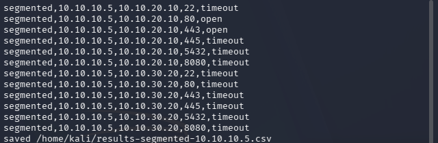
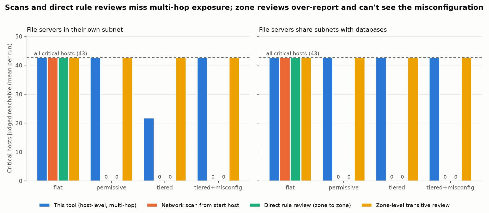

Vellore Institute of Technology School of Computer Science and Engineering

BCSE308P: Computer Networks Lab Fall Semester 2026–2027

Project Review 1

Network Attack Path Mapper

Graph-Based Analysis of Potential Attack Paths in Computer Networks

<table class="team">
<tr><th>Team member</th><th>Registration number</th></tr>
<tr><td>Adithya P</td><td>24BCT0135</td></tr>
<tr><td>Lakshyaraj Singh</td><td>24BCI0076</td></tr>
<tr><td>Dinagar</td><td>24BDS0325</td></tr>
</table>

Faculty: [Faculty name]&nbsp;&nbsp;|&nbsp;&nbsp;Slot: [Slot]

Repository: github.com/Adithya6002/network-attack-path-mapper

## 1. Abstract

Firewall rules are usually reviewed one at a time, so it is hard to see how far an intrusion on one computer could spread through a network. This project builds a tool that models a network as a **directed reachability graph** from its hosts, open services, subnets and first-match firewall rules. From this graph the tool reports which hosts can be reached from a chosen starting host, the routes to critical servers, the **choke points** every route must cross, and the effect of a firewall change before it is deployed.

The core system is fully implemented. In a 4-VM VirtualBox lab with a real iptables router, the tool's predictions matched **72 of 72** measured connections (95% confidence interval for accuracy: 95.0–100%). Simulations of networks of up to 1,000 hosts show that it finds multi-hop exposure that network scans and rule-by-rule reviews miss.

## 2. Problem Statement

- Firewall rules are reviewed individually; their **combined effect** across subnets is hard to reason about.
- Segmentation changes are approved **without a measured effect** on exposure.
- **Multi-hop exposure** is invisible: a server blocked from users may still be reachable through another host.
- Traffic **inside a subnet** never passes the router firewall, so no firewall rule can block it.

**Research question:** given a network's hosts, services and firewall policy, which hosts are reachable from a starting host, along which paths, and how does a policy change alter that?

## 3. Objectives

1. Model network reachability as a graph from hosts, services, subnets and firewall rules.
2. Report reachable hosts, routes to critical servers, choke points and key hosts.
3. Compare firewall policies before deployment.
4. Validate the model against real traffic in a virtual lab.
5. Evaluate the tool against common approaches on larger simulated networks.

## 4. Proposed System

| 1. Discover | 2. Parse | 3. Model | 4. Analyse | 5. Report |
|---|---|---|---|---|
| Nmap XML or network configuration | Hosts, services, subnets, firewall rules (JSON) | Reachability graph (NetworkX) | Hops, routes, choke points, policy comparison | Terminal report and interactive graphs (PyVis) |

**Edge rule.** An edge from host *u* to host *v* exists when at least one open service *s* on *v* is reachable from *u*:

*(u → v)* exists **if and only if** some service *s* on *v* has: same subnet(*u*, *v*) **OR** the firewall allows (*u*, *v*, *s*).

**Model rules**

| Rule | Meaning |
|---|---|
| Same subnet = same L2 segment | Hosts in one subnet reach each other directly; the router firewall never sees this traffic |
| First match wins | Rules are matched on source, destination, port and protocol in order; unmatched traffic gets the default policy |
| Stateful | Replies to permitted connections are allowed, so an edge records who can *start* a connection |
| Edges keep services | Each path is explainable, e.g. web via 80/tcp, then db via 5432/tcp |

## 5. Computer Networks Concepts Applied

IP addressing and CIDR subnetting (bit-mask membership tests), TCP ports and services, inter-subnet routing (IP forwarding), first-match stateful packet filtering (iptables `FORWARD` chain), network segmentation (user LAN / DMZ / internal), and TCP handshake outcomes (open = SYN-ACK, refused = RST, timeout = dropped).

## 6. Implementation Status

| Module | Description | Status |
|---|---|---|
| Data collection | Nmap XML parser; scanner restricted to private IP ranges | Completed |
| Reachability model | Graph construction, first-match firewall evaluation, subnet handling | Completed |
| Path analysis | Hop counts (BFS), route search, choke points (dominator tree), centrality, policy comparison | Completed |
| Visualisation | Interactive before/after network graphs (PyVis) | Completed |
| Virtual lab | 4 VMs, 3 isolated subnets, iptables router generated from the policy file | Completed |
| Lab validation | 72 measured connections compared with model predictions | Completed |
| Large-scale evaluation | 360 simulated runs; comparison with common approaches; scalability to 1,000 hosts | Completed |
| Testing | 41 automated tests; one-command reproducibility script | Completed |
| Hardening recommender | Minimum firewall change that cuts all routes to critical servers | Planned |
| Larger real-network validation | More hosts, UDP, host-based firewalls | Planned |

**Overall:** the core implementation, validation and evaluation are complete, which is more than the 50% required for Review 1. The remaining items extend the work.

## 7. Implementation Details

| Component | Implementation |
|---|---|
| `collector/` | Parses Nmap XML into hosts, ports and services; the scanner refuses public IP ranges |
| `analyzer/graph.py` | Builds the graph; firewall rules pre-compiled into integer masks for speed |
| `analyzer/paths.py` | BFS hop counts; pruned, shortest-first route search; dominator-tree choke points; betweenness centrality; policy diff |
| `visualization/` | PyVis HTML graph: start host, critical hosts, firewall-crossing (dashed) vs. same-subnet (solid) edges, routes to critical hosts in red |
| `lab/` | VM setup scripts, `json_to_iptables.py` (policy file to router rules), `measure.sh`, `compare_results.py` |
| `experiments/` | Synthetic network generator, baseline approaches, experiment runner, figures |

**Tools:** Python, NetworkX, PyVis, Nmap, pytest, Matplotlib, VirtualBox, Ubuntu Server, Kali Linux, iptables, Git/GitHub.

## 8. Results So Far

### 8.1 Sample network (7 hosts, 3 subnets)

| Metric | Baseline policy | Segmented policy |
|---|---|---|
| Reachable-service connections | 34 | 12 |
| Routes to the critical database | 50+ | 2 |
| Hops from start host to database | 1 | 2 (only via web server) |
| Choke points | none | web guards db; db guards file server |

Segmentation forced every route to the database through the web server. The file server remained reachable via the database because both share a subnet, showing that a firewall between subnets cannot stop traffic inside one.

### 8.2 Lab validation (4 VMs, real iptables router)

The router enforced the same policy file the model reads. Each of three VMs attempted TCP connections to the other two hosts on six ports, under two policies (72 tests).

| Policy | Tests | Matched model | 95% CI (exact) |
|---|---|---|---|
| Baseline | 36 | 36 | 90.3–100% |
| Segmented | 36 | 36 | 90.3–100% |
| **Total** | **72** | **72 (100%)** | **95.0–100%** |

No false positives and no false negatives.

*Figure 1: Measurement from the Kali VM under the segmented policy. Only web on ports 80/443 is open; every other connection times out, as the model predicted.*

### 8.3 Large-scale evaluation (360 simulated runs, 100–500 hosts)

| Approach | Finding |
|---|---|
| Network scan from the start host | Missed **100%** of reachable critical hosts under segmented policies (all were multi-hop) |
| Direct rule review | Missed **100%** under segmented policies |
| Zone-level rule review | **49%** false alarms; could not detect an RDP-to-management misconfiguration |
| **This tool** | Detected multi-hop exposure, avoided false alarms, detected the misconfiguration |

*Figure 2: Critical hosts judged reachable by each approach, per firewall policy and network design.*

**Scalability:** a 1,000-host network is analysed in under 15 seconds. Pruned, shortest-first route search reduced one case from 217 s to 1.2 s.

## 9. Novelty

1. Detects **multi-hop** exposure, not only direct connections.
2. Explicitly models **traffic inside subnets**, which firewalls cannot filter and rule-centric analysis ignores.
3. **Validated on a real network**, with the same policy file driving both the model and the lab firewall.
4. **Quantifies failure rates** of common approaches (100% missed, 49% false alarms).
5. Uses **choke points** (dominator trees) to show where defence should be prioritised.

## 10. Work Planned for the Next Review

1. **Hardening recommender:** compute the smallest set of firewall changes that cuts every route to critical servers while keeping required business flows (minimum s–t cut on the reachability graph).
2. **Extended validation:** a larger lab with more hosts, UDP services and host-based firewalls.
3. **Final report and presentation.**

## 11. References

1. O. Sheyner, J. Haines, S. Jha, R. Lippmann, J. M. Wing, "Automated generation and analysis of attack graphs," *Proc. IEEE Symposium on Security and Privacy*, 2002.
2. X. Ou, S. Govindavajhala, A. W. Appel, "MulVAL: A logic-based network security analyzer," *Proc. USENIX Security Symposium*, 2005.
3. T. Lengauer, R. E. Tarjan, "A fast algorithm for finding dominators in a flowgraph," *ACM Transactions on Programming Languages and Systems*, 1979.
4. A. Hagberg, D. Schult, P. Swart, "Exploring network structure, dynamics, and function using NetworkX," *Proc. SciPy*, 2008.
5. C. J. Clopper, E. S. Pearson, "The use of confidence or fiducial limits illustrated in the case of the binomial," *Biometrika*, 1934.
