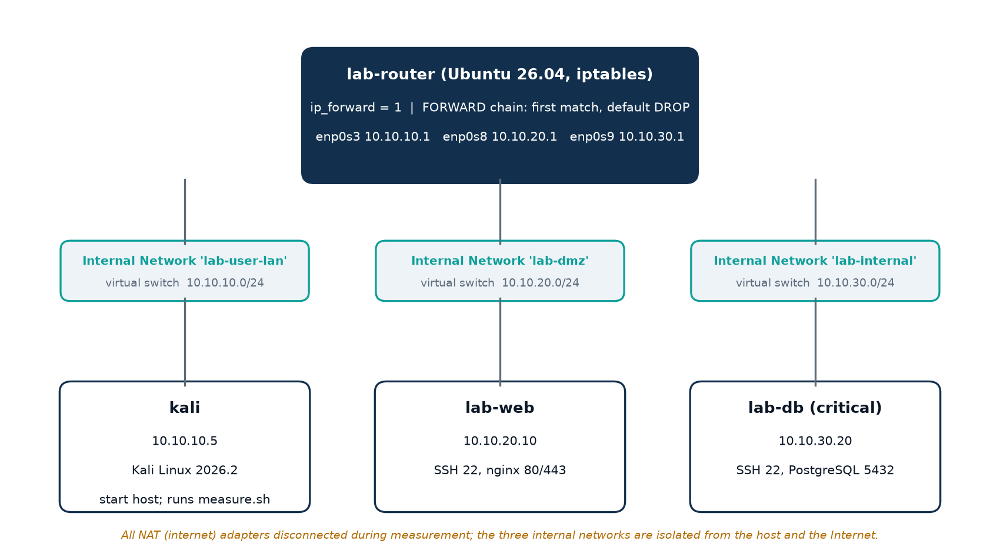
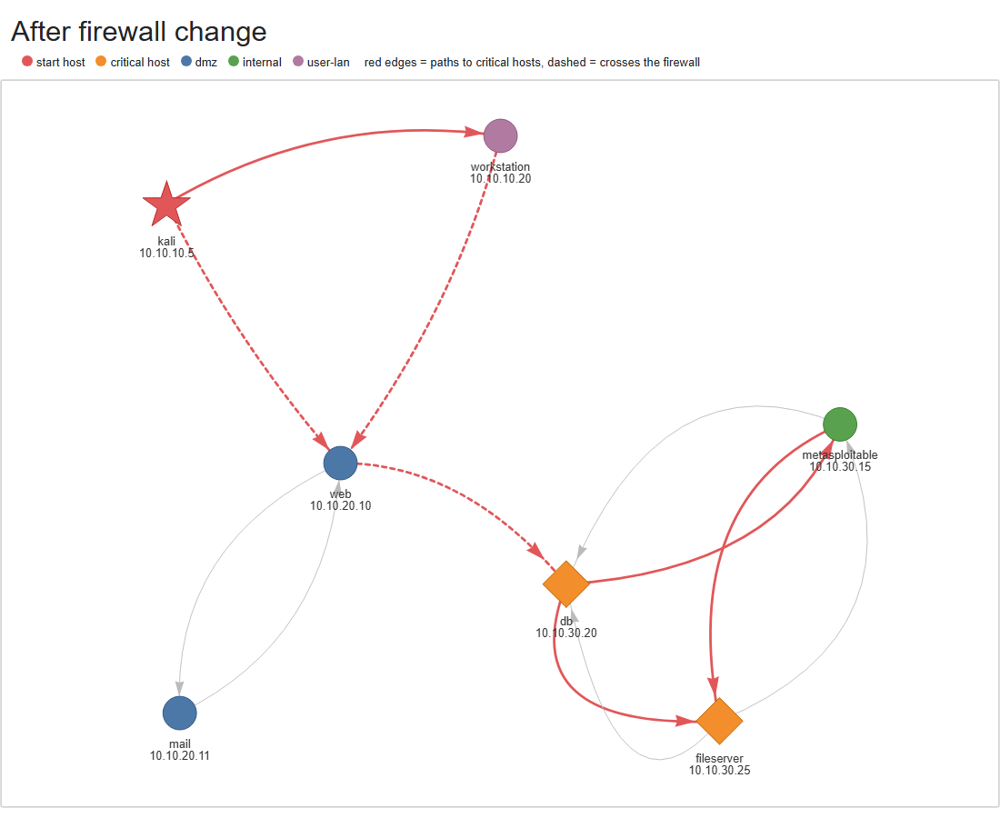
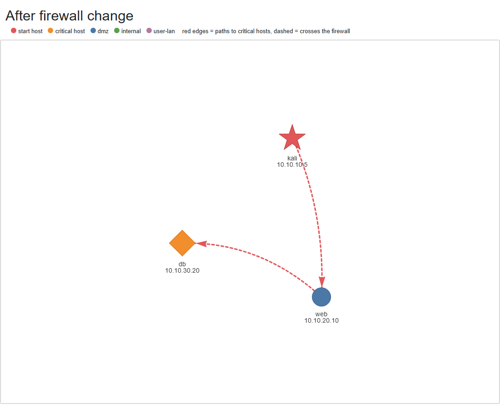

<div class="cover">
<p class="inst">Vellore Institute of Technology<br>School of Computer Science and Engineering</p>
<p class="course">BCSE308P – Computer Networks Lab<br>Fall Semester 2026–2027</p>
<p class="review">Project Review 2 – Final Report</p>
<p class="title">Network Attack Path Mapper</p>
<p class="subtitle">Graph-Based Analysis and Laboratory Validation of Network Reachability Paths under First-Match Firewall Policies</p>
<table class="team">
<tr><th>Team member</th><th>Registration number</th></tr>
<tr><td>Adithya P</td><td>24BCT0135</td></tr>
<tr><td>Lakshyaraj Singh</td><td>24BCI0076</td></tr>
<tr><td>Dinagar</td><td>24BDS0325</td></tr>
</table>
<p class="faculty">Faculty: Anusha N&nbsp;&nbsp;|&nbsp;&nbsp;Slot: F1</p>
<p class="faculty">Submission date: [Submission date]</p>
<p class="repo">Repository: github.com/Adithya6002/network-attack-path-mapper</p>
</div>

## Abstract

Firewall rules are normally reviewed one rule at a time, so the combined effect of many first-match rules across several subnets, and the multi-hop routes they create, is difficult to see. Existing approaches cover parts of this problem. Network scanners observe reachability from one vantage point only [9]. Firewall-analysis tools reason about rule sets rather than hosts and services [5], [6]. Static reachability analysis and header-space analysis verify forwarding behaviour formally but need complete device state [7], [8]. Attack-graph tools additionally require vulnerability data [1]–[3].

This project builds and validates a lightweight **host- and service-level reachability model**. It is built from the hosts, open services, subnets and first-match firewall rules of a network, and explicitly represents the fact that traffic inside a subnet never reaches the router firewall. The model is a directed graph analysed with established algorithms:

- breadth-first search for hop distance;
- a pruned, shortest-first simple-path search;
- immediate dominators for choke points [10], [11];
- betweenness centrality [12];
- a graph difference for before/after policy comparison.

The model was validated in a four-VM VirtualBox laboratory whose iptables router was generated from the **same policy file** the model reads. Across two policies, predictions matched **72 of 72** measured TCP connection outcomes, giving an exact 95% Clopper–Pearson interval for accuracy of **95.0%–100%** [14]. On 360 simulated runs over 100–500-host networks:

- single-vantage scanning and direct rule review reported none of the critical hosts that the model found reachable through two or three hops;
- a zone-level rule review flagged 21.0 non-reachable file servers per run (49.2% of its flags);
- only the model's output changed when a single misconfigured rule was introduced.

After path-search optimisation, a 1,000-host network is analysed in 6–13 s.

The project does **not** introduce a new graph algorithm. Its contribution is the integrated model, the end-to-end model-versus-network validation methodology, and the quantified evaluation of common review practices.

## 1. Introduction

### 1.1 Background and context

Enterprise networks are segmented into zones (user LAN, DMZ, internal servers) joined by routers that filter traffic with ordered access-control rules. On Linux this is the netfilter/iptables `FORWARD` chain, where rules are evaluated in order and the first match decides [15]. Segmentation is a primary defence against lateral movement: if one workstation is compromised, the rules determine what else can be reached.

### 1.2 Problem domain and motivation

Whether a host is reachable depends jointly on:

- IP addressing and subnet membership (CIDR);
- routing between subnets;
- the services each host listens on;
- the order of firewall rules.

Each rule may look reasonable in isolation, yet permitted connections can chain into multi-hop routes to critical servers. Hosts sharing a subnet communicate at Layer 2 without traversing the router, so no router rule can restrict them. These interactions motivate a model that combines all four factors and can be checked against a real network.

### 1.3 Problem statement

> Given a network's hosts, open services, subnets and first-match firewall policy: which hosts are reachable from a given starting host, through which multi-hop routes and choke points, and how does a proposed policy change alter that reachability? And can the model's predictions be shown to agree with the behaviour of a real network?

### 1.4 Scope

- **In scope:** TCP reachability at the network and transport layers; stateful first-match packet filtering at one router; L2 adjacency inside subnets; analysis from a chosen starting host.
- **Out of scope:** vulnerability exploitation and privilege escalation (the tool reports reachability, not compromise); host-based firewalls; UDP; NAT; multiple routers; application-layer controls.

### 1.5 Significance

The tool lets a defender measure the effect of a segmentation change **before** deploying it. It identifies the hosts that every route must cross, which are the natural points for monitoring and hardening. The laboratory validation shows that its predictions correspond to real packet-filtering behaviour.

## 2. Problem Definition and Objectives

### 2.1 Technical problem

Construct a directed graph *G = (V, E)* whose vertices are hosts. An edge *(u, v)* exists if and only if at least one TCP service on *v* is reachable from *u* under the given subnets and firewall policy. Then compute reachability, routes, choke points and policy differences on *G*, and validate the edge predicate against measured connections.

### 2.2 Objectives

- **Primary objective:** a validated reachability model and analysis tool for firewall-segmented networks.
- **Secondary objectives:**
    1. Parse network data from Nmap XML or a JSON description.
    2. Evaluate firewall rules exactly as a first-match stateful packet filter does.
    3. Model intra-subnet (L2) adjacency explicitly.
    4. Report hop distances, routes to critical hosts, choke points and key hosts.
    5. Compare two policies and visualise the result.
    6. Generate router rules from the same policy file, and measure real connections in a virtual lab.
    7. Evaluate the model against common review approaches on larger simulated networks, and measure running time.

### 2.3 Functional requirements

| ID | Requirement | Implemented in |
|---|---|---|
| F1 | Load hosts, services, subnets and policy from JSON; parse Nmap XML | `collector/parser.py`, `main.py` |
| F2 | First-match rule evaluation with default policy | `analyzer/graph.py` |
| F3 | Build the reachability graph with per-edge services | `analyzer/graph.py` |
| F4 | Hop distances, routes, choke points, centrality, policy comparison | `analyzer/paths.py` |
| F5 | Interactive HTML visualisation | `visualization/visualize.py` |
| F6 | Predict the outcome (open / refused / timeout) of any connection | `analyzer/graph.py`, `main.py predict` |
| F7 | Convert a policy file to an iptables script | `lab/json_to_iptables.py` |
| F8 | Measure real connections and score model accuracy | `lab/measure.sh`, `lab/compare_results.py` |

### 2.4 Technical requirements

Python 3, NetworkX [13], PyVis, pytest, Matplotlib; Oracle VirtualBox [16] with Ubuntu Server 26.04 and Kali Linux 2026.2; iptables/netfilter [15]; Git and GitHub. Scanning is restricted to private address ranges.

### 2.5 Expected outcomes

A reachability report and graph for any network description; a before/after comparison of policies; a measured accuracy figure for the model on a real network; and quantitative evidence of where common review approaches err.

## 3. Existing System and Literature Review

### 3.1 Active network scanning

Nmap [9] sends probes from the host on which it runs and classifies ports as open, closed or filtered.

- **Strengths:** observes real behaviour, needs no configuration access, and is widely available.
- **Limitations:** it measures reachability from **one vantage point** only. It cannot report what a second host could reach after the first is compromised. It does not reveal rule order, and it cannot assess a policy before deployment.
- **Relation to this project:** the project's collector can parse Nmap XML as input. The experiments in Section 9.3 quantify what a single-vantage scan misses.

### 3.2 Firewall rule-set analysis

**Fang** [5] builds a model of firewall rule sets and answers queries such as "which services can reach host *X* from subnet *Y*", across several firewalls. **Al-Shaer and Hamed** [6] formally defined rule anomalies (shadowing, correlation, generalisation, redundancy) in centralised and distributed firewalls, and gave algorithms to detect them.

- **Strengths:** reason directly about rules and their order; detect mistakes before deployment.
- **Limitations:** the analysis is **rule- and zone-centric**. Whether a destination host actually listens on a permitted port is outside the rule set, and multi-hop chaining through intermediate hosts is not the object of analysis.
- **Relation:** the "direct rule review" and "zone-level review" baselines in Section 9.3 represent this rule-centric style of analysis.

### 3.3 Static reachability and data-plane verification

**Xie et al.** [7] define the potential reachability provided by a network, computed from the configuration state of every router. Their computation reduces transitive closure to set union and intersection over reachability sets. **Header Space Analysis (HSA)** [8] models packet headers as points in {0,1}^L and network boxes as transfer functions. This allows protocol-agnostic detection of reachability failures, loops and isolation violations.

- **Strengths:** formal and general (multiple devices, rewriting, any header field).
- **Limitations:** they require complete router and ACL configuration state, and the techniques are considerably more complex to apply. Their output is reachability between header spaces or subnets, not host-and-service routes, choke points or exposure of critical assets. They were not designed for the attack-path view of lateral movement.
- **Relation:** the closest methodological relatives of this project's edge predicate, at a coarser practical scale.

### 3.4 Attack graphs

**Sheyner et al.** [1] generated attack graphs automatically with model checking. The state space grows exponentially with network size, which limits scalability. **Ritchey, O'Berry and Noel** [4] extended the model-checking approach by representing TCP/IP connectivity at several layers, so that firewalls, filtering routers and switches can be represented. **MulVAL** [2] expresses vulnerabilities, configuration and reasoning rules in Datalog, analysing networks with thousands of machines in seconds. **NetSPA** [3] targets practical attack-graph generation for network defence by combining reachability computed from firewall rules with vulnerability data.

- **Strengths:** model multi-stage attacks and privilege, not just reachability; mature research tools.
- **Limitations:** they need **vulnerability and host-configuration data**, which may be unavailable or out of date. Their reachability component is a means to an end and is rarely validated in isolation against measured traffic.
- **Relation:** this project deliberately models reachability only, the layer that attack-graph tools build on, and validates that layer empirically.

### 3.5 Graph algorithms used in this project

| Algorithm | Origin | Purpose here |
|---|---|---|
| Breadth-first search | Standard | Minimum hop count from the start host |
| Simple-path enumeration with distance pruning | Standard pruning technique; project-specific procedure | Routes to critical hosts, shortest first |
| Immediate dominators | Lengauer–Tarjan [10]; Cooper–Harvey–Kennedy [11] (as implemented in NetworkX [13]) | Choke points |
| Betweenness centrality | Brandes [12] | Key intermediate hosts |
| Exact binomial confidence interval | Clopper–Pearson [14] | Statistical bound on measured accuracy |

### 3.6 Comparison of established approaches

| Approach | Input needed | Multi-hop | Host/service level | Before deployment | Validated against traffic in the source |
|---|---|---|---|---|---|
| Active scanning [9] | Network access | No | Yes (from one host) | No | Observes traffic directly |
| Rule-set analysis [5], [6] | Rule sets | Not the focus | Rule/zone level | Yes | Not the focus |
| Static reachability / HSA [7], [8] | Full device state | Yes | Header/subnet level | Yes | Formal verification |
| Attack graphs [1]–[4] | Topology, rules, vulnerabilities | Yes | Yes | Yes | Varies |
| **This project** | Hosts, services, subnets, rules | Yes | Yes | Yes | **Yes (72/72, Section 9.2)** |

### 3.7 Limitations motivating the proposed system

1. Scanners cannot see beyond one hop from where they run.
2. Rule-centric analysis does not know which hosts listen on which ports, and does not follow chains of permitted connections.
3. Formal reachability verifiers require full device state and specialist tooling.
4. Attack-graph tools depend on vulnerability data.
5. Intra-subnet adjacency is a well-known property of L2 networks. Its effect on exposure to critical assets is easy to overlook in rule-by-rule review.

## 4. Research Gap

### 4.1 What existing methods accomplish

Rule anomalies can be detected [6]. Rule sets can be queried [5]. Reachability can be computed formally from full configuration state [7], [8]. Multi-stage attacks can be modelled when vulnerability data is available [1]–[3].

### 4.2 What remains insufficiently addressed

For the practical task of **segmentation review**, a reviewer needs:

- multi-hop, host-and-service-level reachability from hosts, services, subnets and rules alone, without vulnerability data or full device dumps;
- explicit treatment of intra-subnet traffic;
- choke points and before/after comparison;
- **evidence that the model's predictions match real packet filtering.**

In the sources reviewed, the reachability layer is either part of a larger attack-graph tool [2], [3] or verified formally [7], [8]. We did not find it evaluated by directly comparing model predictions with measured connection outcomes on a network configured from the same input.

### 4.3 Why it matters here

If the reachability model is wrong, everything built on it (routes, choke points, policy comparisons) is wrong too. And if the review practice in use (scanning or rule-by-rule review) misses multi-hop exposure, a segmented network may be judged safe when it is not.

### 4.4 Gap addressed

A lightweight, validated host-and-service reachability model for segmentation review, together with a quantitative evaluation of how common review practices deviate from it.

### 4.5 Evidence that the gap is addressed

- The model's edge predicate matched 72/72 real measurements (Section 9.2).
- The model detected multi-hop exposure and a misconfiguration that the baseline practices did not (Section 9.3).

**This is not a claim that no other tool can compute reachability.** Static verifiers and attack-graph tools can, given their richer inputs.

## 5. Proposed System

### 5.1 Architecture and workflow

| Stage | 1. Discover | 2. Parse | 3. Model | 4. Analyse | 5. Report | 6. Validate |
|---|---|---|---|---|---|---|
| Input | Nmap XML or network description | Hosts, services, subnets, rules | Parsed network | Reachability graph | Analysis results | Same policy file |
| Output | Raw scan | JSON network model | Directed graph *G* | Hops, routes, choke points, key hosts, policy diff | Terminal report; interactive HTML graph | iptables rules → measured outcomes → confusion matrix |
| Module | `collector/scanner.py` | `collector/parser.py` | `analyzer/graph.py` | `analyzer/paths.py` | `main.py`, `visualization/` | `lab/` |

*Table 1: Processing stages of the proposed system.*

### 5.2 Model rules (design decisions)

| Rule | Rationale |
|---|---|
| Same subnet = same L2 segment: every open service is reachable | Traffic is switched, not routed, so the router firewall never sees it |
| Between subnets, rules are evaluated in order; the first match decides; otherwise the default policy | Matches iptables `FORWARD` semantics [15] |
| Stateful: replies to permitted connections are allowed | Matches `ESTABLISHED,RELATED` handling, so an edge records who can *initiate* a connection |
| Each edge stores the reachable services | Every route can be explained port by port |

### 5.3 Network components

| Component | Responsibility |
|---|---|
| Router (lab-router) | Joins three subnets; IP forwarding; enforces the policy in the `FORWARD` chain |
| Start host (kali) | Represents a compromised user workstation; runs measurements |
| Servers (lab-web, lab-db) | Expose real services (nginx; PostgreSQL); db is the critical asset |
| Analysis host (Windows) | Runs the model, predictions, visualisation, experiments and scoring |

### 5.4 Differences from existing approaches

- **Compared with scanning:** multi-hop, and applicable before deployment.
- **Compared with rule-set analysis:** host- and service-level, and follows chains of connections.
- **Compared with formal verifiers:** uses a deliberately small input (no full device state) and adds attack-path-oriented outputs (choke points, critical-asset routes).
- **Compared with attack graphs:** needs no vulnerability data; the reachability layer is validated on its own.

## 6. Matrix Analysis and Mathematical Formulation

All matrices below were produced by running the project's code on its own data files (`data/lab.json`, `data/network.json`, `data/firewall_segmented.json`, `evidence/measurements.csv`). None was typed in by hand.

### 6.1 Edge predicate

Let *H* be the set of hosts, *net(h)* the subnet of host *h*, *S(v)* the set of open TCP ports on *v*, and *F* the ordered rule list with default action *d*. The firewall decision for a packet from *u* to *v* on port *p* is:

*allow_F(u, v, p)* = action of the **first** rule *r* in *F* whose source contains *u*, destination contains *v*, and port set contains *p*; otherwise *d*.

The **reachability matrix** *R* (|*H*| × |*H*|) is:

*R[u][v]* = { *p* ∈ *S(v)* : *net(u)* = *net(v)* **or** *allow_F(u, v, p)* }

and the **adjacency matrix** *A* is *A[u][v]* = 1 if *R[u][v]* ≠ ∅, else 0.

Subnet membership uses the CIDR mask test: (*ip* AND *mask*) = *network*.

### 6.2 Lab reachability matrices *R* (3 × 3)

Rows are sources and columns are destinations. Each entry lists the reachable ports. **F** means the connection crosses the firewall; **S** means same subnet; **0** means no edge.

| from \ to | kali | web | db |
|---|---|---|---|
| kali | – | F 22, 80, 443 | F 22 |
| web | 0 | – | F 22, 5432 |
| db | 0 | F 22, 80, 443 | – |

*Table 2: Lab reachability matrix, baseline policy (4 edges).*

| from \ to | kali | web | db |
|---|---|---|---|
| kali | – | F 80, 443 | 0 |
| web | 0 | – | F 5432 |
| db | 0 | 0 | – |

*Table 3: Lab reachability matrix, segmented policy (2 edges).*

**Worked example, *R[kali][db]* under the baseline policy.** *S(db)* = {22, 5432}, and kali and db are in different subnets. For port 22, rule 1 (user-lan → DMZ) does not match the destination, and rule 2 (user-lan → internal, ports 22 and 445) matches, so the result is **allow**. For port 5432, no rule matches, so the default **deny** applies. Hence *R[kali][db]* = {22}. Kali has no listening services, so its column is empty in both matrices.

**Interpretation.** Segmentation halves the edges (4 → 2). It removes the direct kali → db edge, so the only route from kali to db is kali → web → db, through port 5432.

### 6.3 Sample-network adjacency (7 × 7)

| from \ to | kali | workstation | web | mail | metasploitable | db | fileserver |
|---|---|---|---|---|---|---|---|
| kali | – | S | F | F | F | F | F |
| workstation | 0 | – | F | F | F | F | F |
| web | 0 | 0 | – | S | F | F | F |
| mail | 0 | 0 | S | – | F | F | F |
| metasploitable | 0 | F | F | F | – | S | S |
| db | 0 | F | F | F | S | – | S |
| fileserver | 0 | F | F | F | S | S | – |

*Table 4: Sample network, baseline policy. Row sums 6, 5, 4, 4, 5, 5, 5 give 34 edges.*

| from \ to | kali | workstation | web | mail | metasploitable | db | fileserver |
|---|---|---|---|---|---|---|---|
| kali | – | S | F | 0 | 0 | 0 | 0 |
| workstation | 0 | – | F | 0 | 0 | 0 | 0 |
| web | 0 | 0 | – | S | 0 | F | 0 |
| mail | 0 | 0 | S | – | 0 | 0 | 0 |
| metasploitable | 0 | 0 | 0 | 0 | – | S | S |
| db | 0 | 0 | 0 | 0 | S | – | S |
| fileserver | 0 | 0 | 0 | 0 | S | S | – |

*Table 5: Sample network, segmented policy. Row sums 2, 1, 2, 1, 2, 2, 2 give 12 edges.*

**Interpretation.** The six **S** entries among metasploitable, db and fileserver remain under **both** policies. They are intra-subnet edges that no router rule can remove. This is why the file server stays reachable after segmentation, through db, in 3 hops.

Derived results for start host kali:

| Measure | Baseline | Segmented |
|---|---|---|
| Hop distance to db / fileserver | 1 / 1 | 2 / 3 |
| Routes to db / fileserver (enumeration capped at 50, up to 4 hops) | 50+ / 50+ | 2 / 3 |
| Choke points (immediate dominator → hosts it guards) | none | web → {mail, db}; db → {metasploitable, fileserver} |
| Highest betweenness | 0.022 (metasploitable, db, fileserver) | 0.367 (web), 0.267 (db) |

*Table 6: Analysis results derived from Tables 4 and 5.*

### 6.4 Measurement matrices *M* (6 source–destination pairs × 6 ports)

Each entry is a **real** connection outcome recorded in the lab (`evidence/measurements.csv`): **O** = open (handshake completed), **R** = refused (TCP reset: the firewall allowed it, nothing listening), **T** = timeout (dropped by the router).

| source → destination | 22 | 80 | 443 | 445 | 5432 | 8080 |
|---|---|---|---|---|---|---|
| kali → web | O | O | O | R | R | R |
| kali → db | O | T | T | R | T | T |
| web → kali | T | T | T | T | T | T |
| web → db | O | R | R | R | O | R |
| db → kali | R | R | R | R | R | R |
| db → web | O | O | O | R | R | R |

*Table 7: Measured outcomes, baseline policy (9 O, 17 R, 10 T).*

| source → destination | 22 | 80 | 443 | 445 | 5432 | 8080 |
|---|---|---|---|---|---|---|
| kali → web | T | O | O | T | T | T |
| kali → db | T | T | T | T | T | T |
| web → kali | T | T | T | T | T | T |
| web → db | T | T | T | T | O | T |
| db → kali | T | T | T | T | T | T |
| db → web | T | T | T | T | T | T |

*Table 8: Measured outcomes, segmented policy (3 O, 0 R, 33 T).*

**How the model predicts *M*.** For pair (*u*, *v*) and port *p*:

- **T** if not (*net(u)* = *net(v)* or *allow_F(u, v, p)*);
- **O** if the firewall passes it and *p* ∈ *S(v)*;
- **R** otherwise.

The ports include services that do not exist (445 and 8080 on every host), so the measurement tests the **firewall decision** independently of the **service set**.

**Interpretation.** Row "kali → db" under the baseline shows the two components separating. Port 445 is **R** (rule 2 allows it, but db does not listen on 445), while port 5432 is **T** (no rule allows it). Row "db → kali" is all **R**, because the internal → any rule allows everything and kali listens on nothing.

### 6.5 Confusion matrices

Two binary predictions are scored on every measured connection:

- **Firewall decision**, where positive = traffic passes (O or R);
- **Service reachability**, where positive = connection open (O).

| Policy / check | TP | TN | FP | FN | Accuracy | 95% CI (exact) |
|---|---|---|---|---|---|---|
| Baseline, firewall decision | 26 | 10 | 0 | 0 | 100% | 90.3–100% |
| Baseline, service reachability | 9 | 27 | 0 | 0 | 100% | 90.3–100% |
| Segmented, firewall decision | 3 | 33 | 0 | 0 | 100% | 90.3–100% |
| Segmented, service reachability | 3 | 33 | 0 | 0 | 100% | 90.3–100% |
| **All, firewall decision** | **29** | **43** | **0** | **0** | **100%** | **95.0–100%** |
| **All, service reachability** | **12** | **60** | **0** | **0** | **100%** | **95.0–100%** |

*Table 9: Confusion matrices for the model's predictions versus measurements.*

The counts follow directly from Tables 7 and 8. For example, in the baseline, firewall positives = O + R = 9 + 17 = 26, and negatives = T = 10.

**Accuracy** = (TP + TN) / (TP + TN + FP + FN).

**Exact confidence interval.** When all *n* trials are correct (*k* = *n*), the Clopper–Pearson lower bound at level 1 − α is (α/2)^(1/*n*) [14]:

- *n* = 72: 0.025^(1/72) = e^(ln 0.025 / 72) = e^(−0.05124) = **0.9500**;
- *n* = 36: 0.025^(1/36) = **0.9026**.

The upper bound is 1. The bisection implementation in `lab/compare_results.py` reproduces these values (unit-tested).

### 6.6 Assumptions and limitations of the matrices

- *R* and *A* assume a single filtering router, TCP only, and no host firewalls. These assumptions held in the lab.
- *M* covers 6 ports and 3 measuring hosts; it is a sample of the connection space, not all of it.
- The route counts in Table 6 are capped at 50 by design (`PATH_LIMIT`).

## 7. Algorithm Design and Analysis

Notation: *H* hosts, *E* edges, *S* services per host (maximum), *P* firewall rules, *k* the hop limit, *L* the path limit, *T* critical targets.

### 7.1 A1 – First-match firewall decision (established semantics; project implementation)

- **Input:** pre-compiled rules (source and destination as integer network/mask pairs, port set, protocol, action); packet (*u*, *v*, *p*).
- **Output:** allow or deny.

```text
pair_rules = [r in rules if (u AND r.src_mask) == r.src_net and (v AND r.dst_mask) == r.dst_net]
for r in pair_rules (in order):
    if (r.ports is any or p in r.ports) and r.proto in {any, tcp}: return r.action
return default
```

- **Complexity:** O(*P*) time per host pair, O(1) extra space.
- **Role:** core of the edge predicate.
- **Project optimisation:** CIDRs are compiled once to integer masks, and rules are filtered once per host pair rather than once per port.

### 7.2 A2 – Reachability graph construction (project-specific procedure)

```text
for each host u:
    for each host v != u:
        if net(u) == net(v): services = S(v)
        else: services = [p in S(v) if A1(u, v, p) == allow]
        if services: add edge (u, v, services, same_segment)
```

- **Complexity:** O(*H*² · *S* · *P*) time; O(*H* + *E*·*S*) space, with *E* ≤ *H*(*H* − 1).
- **Strengths:** exact with respect to the model rules, and simple to audit.
- **Limitation:** quadratic in the number of hosts. 887,112 edges at 1,000 hosts under the flat policy (Section 9.4).

### 7.3 A3 – Hop distance (established: breadth-first search)

Single-source BFS from the start host on *G*.

- **Complexity:** O(*H* + *E*) time and space.
- **Output:** minimum hops to every reachable host.

### 7.4 A4 – Routes to critical hosts (established pruning technique; project-specific procedure)

```text
dist_to_t = BFS on reversed G from target t (cutoff k)
for length = dist_to_t[start] .. k:
    DFS from start building simple paths of exactly `length` edges;
    skip neighbour n if n is already on the path or dist_to_t[n] > remaining - 1;
    stop when L paths have been collected
```

- **Complexity:** O(*H* + *E*) for the reverse BFS per target. The enumeration is exponential in *k* in the worst case, O(Δ^*k*) for maximum out-degree Δ, but bounded by *L* and pruned to nodes that can still reach the target in time.
- **Correctness:** for 20 random graphs, the path set equals NetworkX's `all_simple_paths` with the same cutoff (unit test).
- **Effect:** the 1,000-host tiered analysis fell from 217.6 s (unpruned enumeration) to 1.2 s.

### 7.5 A5 – Choke points (established: immediate dominators [10], [11])

Host *D* dominates *T* if every path from the start to *T* passes through *D*. The project uses NetworkX's `immediate_dominators` [13] and reports each immediate dominator (other than the start) with the hosts it guards.

- **Complexity:** the Cooper–Harvey–Kennedy iterative algorithm [11] is O(*H*²) in the worst case but fast in practice. Lengauer–Tarjan [10] achieves near-linear time.
- **Role:** identifies where monitoring or hardening covers every route.
- **Application:** using dominators to name segmentation choke points is an application of an established algorithm, not a new algorithm.

### 7.6 A6 – Key hosts (established: Brandes betweenness [12])

- **Complexity:** O(*H*·*E*) time for unweighted graphs. Above 64 hosts, the project samples 64 source hosts with a fixed seed, giving O(64·*E*).
- **Limitation:** sampled values are estimates.

### 7.7 A7 – Connection outcome prediction (project-specific)

```text
if not (net(u) == net(v) or A1(u, v, p) == allow): return timeout
return open if p in S(v) else refused
```

- **Complexity:** O(*P* + *S*) per connection.
- **Role:** produces the predictions scored in Section 6.5, and the live `predict` command.

### 7.8 A8 – Policy-to-iptables compilation (project-specific)

Each JSON rule becomes `iptables -A FORWARD -s … -d … -p … -m multiport --dports … -j ACCEPT|DROP`. The generated script prepends:

- a flush;
- the default policy;
- an isolation guard;
- an `ESTABLISHED,RELATED` accept.

Properties:

- **Complexity:** O(*P*).
- **Role:** guarantees the model and the router use the same policy. A test checks that the deployed scripts are byte-identical to the generated output.

### 7.9 A9 – Validation scoring (established statistics [14])

Confusion matrix over measured rows, plus the exact binomial interval found by bisection on the binomial CDF.

- **Complexity:** O(*n*) for scoring, O(*n*) per bisection step, 60 steps.

## 8. Implementation Details

### 8.1 Environment

- **Host:** Windows 11, 12 threads, 15.6 GB RAM.
- **Software:** Python 3.13, NetworkX, PyVis, pytest, Matplotlib; VirtualBox 7.2.8 (running through the Hyper-V backend because WSL2 is present).
- **VMs:** Ubuntu Server 26.04.1 (router, web, db; 2 vCPU each) and Kali Linux 2026.2.

### 8.2 Network configuration



*Figure 1: Validation-lab topology. Three VirtualBox internal networks act as isolated virtual switches; lab-router is the only link between them.*

- **Addressing:** each subnet is a VirtualBox internal network (virtual switch). lab-router has one interface per subnet (10.10.10.1, 10.10.20.1, 10.10.30.1) with `net.ipv4.ip_forward=1`.
- **Routing:** each host has a static route `10.10.0.0/16 via <its gateway>`. A ping from kali to web returns TTL 63 (64 − 1), confirming that traffic is routed through the router.
- **Isolation:** all NAT adapters were disconnected before measurement.

### 8.3 Modules

| Module | Responsibility |
|---|---|
| `collector/parser.py`, `scanner.py` | Nmap XML to JSON; scanning restricted to private ranges |
| `analyzer/graph.py` | A1, A2, A7 |
| `analyzer/paths.py` | A3–A6, policy comparison |
| `visualization/visualize.py` | Interactive HTML graph (PyVis): start host, critical hosts, firewall-crossing (dashed) vs. same-subnet (solid) edges, routes to critical hosts in red |
| `lab/json_to_iptables.py`, `measure.sh`, `compare_results.py` | A8, measurement, A9 |
| `experiments/` | Network generator, baseline approaches, experiment runner, figures |
| `tests/` | 42 automated tests |

### 8.4 Key code sections

Edge construction (`analyzer/graph.py`, abridged):

```python
for src in network["hosts"]:
    for dst in network["hosts"]:
        if src["ip"] == dst["ip"]:
            continue
        same_segment = src_subnet != "unknown" and src_subnet == graph.nodes[dst["ip"]]["subnet"]
        if same_segment:
            services = list(dst.get("ports", []))
        else:
            pair_rules = _rules_for_pair(rules, addr[src["ip"]], addr[dst["ip"]])
            services = [p for p in dst.get("ports", [])
                        if _decide(pair_rules, default_allow, p["port"], p.get("proto", "tcp"))]
        if services:
            graph.add_edge(src["ip"], dst["ip"], services=services, same_segment=same_segment)
```

Choke points (`analyzer/paths.py`):

```python
dominators = nx.immediate_dominators(graph, start)
for node, dom in dominators.items():
    if node != start and dom != start:
        guarded.setdefault(dom, []).append(node)
```

Measurement (`lab/measure.sh`, core loop):

```bash
timeout 3 bash -c "</dev/tcp/$dst/$port" 2>/dev/null
case $? in 0) result=open ;; 124) result=timeout ;; *) result=refused ;; esac
```

### 8.5 Correspondence with the design

Each design rule in Section 5.2 maps to code:

- same-subnet → `same_segment`;
- first match → `_decide`;
- stateful → `ESTABLISHED,RELATED` in A8, with edges defined by connection initiation;
- per-edge services → the `services` edge attribute.

### 8.6 Corrections from Review 1 and work since Review 1

**No corrections were issued in Review 1.** Work completed since Review 1:

1. A `predict` command (A7) that prints the model's outcome for every connection before a policy is applied, in the same order as `measure.sh`. A unit test confirms it reproduces all 72 recorded outcomes.
2. A documented 15-minute live-validation procedure with a user-chosen policy (`CUSTOM_DEMO.md`). For the example policy `data/firewall_custom.json` the model predicts 36 outcomes: 3 open, 1 refused, 32 timeout. **The live measurement of this policy is to be performed during the Review 2 presentation and is not reported here as a result.**
3. Test suite expanded to 42 tests; lab-connection and implementation demonstration guides.

## 9. Experimental Setup and Results

### 9.1 Sample-network analysis

Inputs: `data/network.json` (7 hosts, 3 subnets) with the baseline policy, and `data/firewall_segmented.json`. Results are in Tables 4–6.



*Figure 2: Tool output for the sample network after segmentation. The only firewall-crossing route to db goes through web (dashed). Solid red edges inside the internal subnet cannot be filtered by the router.*

### 9.2 Laboratory validation

- **Procedure:** apply a policy on lab-router; run `bash ~/measure.sh <policy>` on kali, web and db (2 destinations × 6 ports each, 3 s timeout); repeat for the second policy. That gives 72 connections, scored against A7.
- **Results:** Tables 7–9. All 72 predictions were correct, with no false positives or false negatives, and accuracy is ≥ 95.0% at 95% confidence.



*Figure 3: Tool output for the real lab under the segmented policy: kali → web (80/443) → db (5432).*


*Figure 4: Raw measurement on the kali VM under the segmented policy. Only web on 80/443 is open, matching Table 8.*

**Effect of segmentation, measured:**

- open connections fell from 9 to 3;
- firewall-passing connections fell from 26 to 3;
- the kali → db distance rose from 1 to 2 hops, with web as the only route.

### 9.3 Comparison with common review practices (simulation)

- **Networks:** 100, 250 and 500 hosts (3 seeds each); five zones (user 45%, DMZ 10%, app 20%, data 15%, management 10%), two subnets per zone; data-zone hosts are critical (about 60% databases, 40% file servers).
- **Designs:** *mixed* (file servers share subnets with databases) and *separated*.
- **Policies:** flat; permissive; tiered; tiered + one misconfiguration (users allowed RDP to management hosts).
- **Start hosts:** 5 random user hosts per network. That gives 360 runs in total.
- **Baselines:**
    - single-vantage scan: one-hop neighbours of the start host;
    - direct rule review: hosts in subnets with a direct allow rule from the start's subnet;
    - zone-level review: transitive closure over subnet-to-subnet rules, ignoring services.

**The model is the reference in this experiment, so these results measure how the baselines deviate from the laboratory-validated model.** They are not an independent measurement of ground truth.

| Design | Policy | Critical total | Model: reachable | of which file servers | within 2 hops | Scan: seen / missed | Direct review: flagged / missed | Zone review: flagged / false alarms |
|---|---|---|---|---|---|---|---|---|
| separated | flat | 42.7 | 42.7 | 21.0 | 42.7 | 42.7 / 0.0 | 42.7 / 0.0 | 42.7 / 0.0 |
| separated | permissive | 42.7 | 42.7 | 21.0 | 42.7 | 0.0 / 42.7 | 0.0 / 42.7 | 42.7 / 0.0 |
| separated | tiered | 42.7 | 21.7 | 0.0 | 0.0 | 0.0 / 21.7 | 0.0 / 21.7 | 42.7 / 21.0 |
| separated | tiered+misconfig | 42.7 | 42.7 | 21.0 | 37.8 | 0.0 / 42.7 | 0.0 / 42.7 | 42.7 / 0.0 |
| mixed | flat | 42.7 | 42.7 | 17.3 | 42.7 | 42.7 / 0.0 | 42.7 / 0.0 | 42.7 / 0.0 |
| mixed | permissive | 42.7 | 42.7 | 17.3 | 42.7 | 0.0 / 42.7 | 0.0 / 42.7 | 42.7 / 0.0 |
| mixed | tiered | 42.7 | 42.7 | 17.3 | 0.0 | 0.0 / 42.7 | 0.0 / 42.7 | 42.7 / 0.0 |
| mixed | tiered+misconfig | 42.7 | 42.7 | 17.3 | 38.4 | 0.0 / 42.7 | 0.0 / 42.7 | 42.7 / 0.0 |

*Table 10: Mean critical hosts per run (`experiments/results/summary.md`).*


*Figure 5: Critical hosts judged reachable by each approach, per policy and design.*

### 9.4 Scalability

| Hosts | Edges (flat) | flat | permissive | tiered | tiered+misconfig |
|---|---|---|---|---|---|
| 50 | 2,058 | 0.019 s | 0.015 s | 0.011 s | 0.012 s |
| 250 | 55,029 | 0.447 s | 0.377 s | 0.270 s | 0.312 s |
| 500 | 221,057 | 1.554 s | 1.698 s | 0.990 s | 1.310 s |
| 1,000 | 887,112 | 6.179 s | 11.084 s | 10.499 s | 12.819 s |

*Table 11: Build + full analysis time, seed 0, single run (`experiments/results/scaling.csv`). Timings vary by roughly ±20% between runs.*

### 9.5 Limitations of the experiments

- **Lab size:** 3 measuring hosts, 6 ports, 2 policies, TCP only.
- **Synthetic networks:** zone sizes, services and policies follow common patterns but are not real enterprise data.
- **Reference model:** the simulated comparison uses the validated model as its reference.
- **Baselines:** re-implementations of each category, not executions of specific products.
- **Timings:** single runs.

### 9.6 Reproducibility

`.\reproduce.ps1` re-runs the 42 tests, the sample analysis, the lab scoring, the lab before/after analysis, and all experiments and figures (about 5 minutes; no VMs needed). The generator uses fixed seeds, so Table 10 is deterministic.

## 10. Comparison with Existing Methods and Algorithms

### Table A: Algorithm comparison

| Algorithm | Operating principle | Time complexity | Space | Advantages | Limitations | Suitability for this project |
|---|---|---|---|---|---|---|
| BFS | Level-by-level expansion | O(*H*+*E*) | O(*H*) | Exact minimum hops | Unweighted only | Hop distance (used) |
| Unpruned simple-path enumeration | DFS over all simple paths up to *k* | Exponential in *k* | O(*k*) per path | Complete | 217.6 s at 1,000 hosts (tiered) | Replaced by A4 |
| Pruned shortest-first enumeration (A4) | Reverse-BFS distance prunes branches; enumerate by length | Worst case exponential in *k*, bounded by *L* | O(*H*) | Same path set (tested); 1.2 s at 1,000 hosts | Still exponential in *k* in the worst case | Routes to critical hosts (used) |
| Dominators, Cooper–Harvey–Kennedy [11] | Iterative data-flow on reverse post-order | O(*H*²) worst | O(*H*) | Simple; fast in practice | Quadratic worst case | Choke points (used, via NetworkX) |
| Dominators, Lengauer–Tarjan [10] | DFS + path compression | O(*E*·α(*E*,*H*)) | O(*H*) | Near-linear | More complex | Alternative for very large graphs |
| Brandes betweenness [12] | Single-source shortest paths with dependency accumulation | O(*H*·*E*) | O(*H*+*E*) | Exact | Slow on dense graphs | Key hosts (sampled above 64 hosts) |
| Model checking [1] | State-space exploration | Exponential in state variables | Exponential | Expressive | State explosion | Not used (no vulnerability states needed) |
| Datalog reasoning [2] | Logic rules, fixpoint evaluation | Polynomial (as reported in [2]) | Polynomial | Scales to thousands of hosts | Needs vulnerability data | Not used |

### Table B: Existing approaches vs. proposed system

| Evaluation criterion | Existing approach | Proposed approach | Evidence or justification |
|---|---|---|---|
| Multi-hop exposure | Scan: one hop only [9] | Graph reachability over all hosts | Table 10: scan saw 0 of 21.7–42.7 reachable critical hosts |
| Service awareness | Rule/zone review: rule-level [5], [6] | Per-host open services in the edge predicate | Table 10: zone review 21.0 false alarms (separated, tiered) |
| Intra-subnet traffic | Easy to overlook in rule-by-rule review | Explicit same-segment edges | Tables 4–5: the six S edges persist under both policies |
| Misconfiguration sensitivity | Zone review: identical output with and without the bad rule | Output changes | Table 10: file servers 0.0 → 21.0; within 2 hops 0.0 → 37.8 |
| Input requirements | Attack graphs need vulnerability data [1]–[3]; verifiers need full device state [7], [8] | Hosts, services, subnets, rules | Sections 2.4, 8 |
| Evidence of model correctness | Formal [7], [8] or not the focus | Measured against a real network | Table 9: 72/72; CI 95.0–100% |
| Before-deployment comparison | Scan: needs deployment | Built-in policy comparison | Sections 6.3, 9.1 |

### Table C: Quantitative performance comparison

Formulas:

- *lower-is-better* metrics: absolute difference = baseline − proposed; percentage reduction = (baseline − proposed) / baseline × 100%;
- *higher-is-better* metrics: percentage-point (pp) difference.

| Metric | Baseline method | Proposed method | Absolute difference | Percentage | Experimental evidence |
|---|---|---|---|---|---|
| Reachable critical hosts reported (separated, tiered; higher is better; reference = validated model) | Scan: 0.0 of 21.7 | 21.7 of 21.7 | +21.7 hosts | 0% → 100% of reachable hosts reported (+100 pp) | Table 10 |
| False alarms on critical hosts (separated, tiered; lower is better) | Zone review: 21.0 | 0.0 | 21.0 | 100% reduction (zone review false-alarm share 21.0/42.7 = 49.2%) | Table 10 |
| Change detected when one misconfigured rule is added (separated; higher is better) | Zone review: 0.0 hosts | +21.0 hosts (file servers); +37.8 within 2 hops | 21.0 | Not defined (baseline 0) | Table 10 |
| Path-search time, 1,000 hosts, tiered (lower is better) | Unpruned enumeration: 217.6 s | Pruned A4: 1.21 s | 216.4 s | 99.4% reduction (179.8× speed-up) | Run logs, Section 7.4 |
| Prediction accuracy on real network (higher is better) | No comparable baseline measured | 100% (72/72) | Not applicable | 95% CI 95.0–100% | Table 9 |

*Note on the last row:* scanning observes real outcomes rather than predicting them, so its "accuracy" is not comparable. A meaningful baseline for accuracy would be another predictive tool run on the same lab. **This is unmeasured and listed in Section 12.**

### Table D: Novelty and research contribution

| Closest existing approach | Known limitation | Proposed contribution | What is actually new | Supporting evidence |
|---|---|---|---|---|
| Static reachability analysis [7] / HSA [8] | Needs full router state; reachability at subnet or header-space level; no critical-asset routes or choke points | Small-input host/service reachability with routes, dominator choke points, policy diff | Integration and application to segmentation review; not a new reachability algorithm | Sections 5–7 |
| NetSPA [3] / MulVAL [2] | Needs vulnerability data; reachability layer not validated in isolation against traffic | Validated reachability layer, usable without vulnerability data | Validation methodology: same policy file drives model and router; three-outcome measurement separates firewall and service effects | Tables 7–9 |
| Rule-set analysis [5], [6] | Rule/zone level; not host-service or multi-hop | Host-service multi-hop model including L2 bypass | Quantified deviation of rule-centric review: 49.2% false alarms; misconfiguration not visible | Table 10 |
| Single-vantage scanning [9] | One hop | Model-based multi-hop view | Quantified miss rate of single-vantage scanning under segmented policies | Table 10 |

### 10.1 Interpretation of the tables

Table A shows that every analysis algorithm is established. The only performance-relevant change is applying distance pruning and shortest-first ordering to path enumeration, which preserved results (tested) and removed the dominant cost.

Table B and Table C show that the model's advantages are qualitative capabilities (multi-hop, service-aware, intra-subnet), each of which produces a measurable difference in the simulated comparison.

Table D places the contribution in **integration, validation methodology and empirical evaluation**, not in algorithm design.

## 11. Novelty and Original Contribution of the Proposed System

| Type | Assessment |
|---|---|
| Algorithmic novelty | **None claimed.** BFS, dominators [10], [11], betweenness [12] and the exact binomial interval [14] are established; the path search uses standard pruning. |
| Architectural / methodological | The validation architecture: one policy file compiled both into the model and into the router's iptables, with measurements that separate firewall decisions (timeout vs. reset) from service presence (open vs. reset). |
| Implementation-level | Pre-compiled integer-mask rule matching; pruned shortest-first path search (180× faster on the largest case); a `predict` command for live comparison; 42 tests; one-command reproducibility. |
| Application-specific | Dominator-based choke points and before/after graph comparison applied to segmentation review, with explicit L2 bypass edges. |
| Empirical | Measured accuracy on a real network (72/72, CI 95.0–100%), and quantified deviations of common review practices (Table 10). |

**Evidence:** Tables 7–11 and Figures 2–5, all reproducible with `reproduce.ps1`.

**Unverified aspects:**

- accuracy on larger and more varied real networks (UDP, host firewalls, multiple routers);
- comparison with an independent predictive tool on the same lab;
- the live custom-policy validation, which is to be performed during the presentation.

**Honest assessment:** the degree of novelty is **moderate and applied**. The work contributes a validated, practical integration and an evaluation methodology, not a new theory or algorithm.

## 12. Limitations and Future Work

### 12.1 Current limitations

- **Model scope:** TCP only, one filtering router, no host firewalls, no NAT, no routing failures.
- **Reachability only:** a reachable port does not imply the host can be compromised.
- **Graph size:** construction is O(*H*²·*S*·*P*), with 887,112 edges at 1,000 hosts (flat policy).
- **Path counts** are capped (50) and betweenness is sampled above 64 hosts.
- **Validation scale:** 72 connections from 3 hosts.
- **Synthetic evaluation:** uses the model as its reference.

### 12.2 Future work

1. **Hardening recommender (not implemented).** Compute the smallest set of firewall changes that removes every route to critical hosts while keeping required business flows. This can be formulated as a minimum s–t cut on the reachability graph, with intra-subnet and required-flow edges given infinite capacity.
2. **Larger validation:** more hosts, UDP services, host-based firewalls, multiple routers; repeated measurement runs.
3. **Independent comparison:** run an established tool on the same lab configuration and compare predictions.
4. **Scalability:** compute edges per subnet pair instead of per host pair, to reduce the quadratic construction cost.

## 13. Conclusion

The project addressed a practical gap in segmentation review: seeing multi-hop, host-and-service-level reachability, including traffic that never reaches the firewall, with evidence that the model reflects reality. A directed reachability graph is built from hosts, services, subnets and first-match rules, and analysed with established algorithms (BFS, pruned path search, immediate dominators, betweenness).

The model's predictions matched all 72 connections measured in a four-VM lab configured from the same policy file (95% CI 95.0–100%). In 360 simulated runs, single-vantage scanning and direct rule review reported none of the critical hosts reachable through multiple hops, while a zone-level review produced 49.2% false alarms and did not reflect a misconfiguration that the model detected. The tool analyses 1,000-host networks in seconds.

The contribution lies in the validated integration, the model-versus-network validation methodology, and the quantified evaluation of review practices, not in a new algorithm. The main next steps are an optimal hardening recommender and larger-scale validation.

## 14. References

[1] O. Sheyner, J. Haines, S. Jha, R. Lippmann, and J. M. Wing, "Automated generation and analysis of attack graphs," in *Proc. IEEE Symp. Security and Privacy*, Oakland, CA, USA, 2002, pp. 254–265, doi: 10.1109/SECPRI.2002.1004377.

[2] X. Ou, S. Govindavajhala, and A. W. Appel, "MulVAL: A logic-based network security analyzer," in *Proc. 14th USENIX Security Symp.*, Baltimore, MD, USA, 2005, pp. 113–128.

[3] K. Ingols, R. Lippmann, and K. Piwowarski, "Practical attack graph generation for network defense," in *Proc. 22nd Annu. Computer Security Applications Conf. (ACSAC)*, Miami Beach, FL, USA, 2006, pp. 121–130.

[4] R. W. Ritchey, B. O'Berry, and S. Noel, "Representing TCP/IP connectivity for topological analysis of network security," in *Proc. 18th Annu. Computer Security Applications Conf. (ACSAC)*, 2002, pp. 25–34.

[5] A. Mayer, A. Wool, and E. Ziskind, "Fang: A firewall analysis engine," in *Proc. IEEE Symp. Security and Privacy*, Oakland, CA, USA, 2000, pp. 177–187.

[6] E. S. Al-Shaer and H. H. Hamed, "Discovery of policy anomalies in distributed firewalls," in *Proc. IEEE INFOCOM*, 2004, pp. 2605–2616, doi: 10.1109/INFCOM.2004.1354680.

[7] G. G. Xie, J. Zhan, D. A. Maltz, H. Zhang, A. Greenberg, G. Hjalmtysson, and J. Rexford, "On static reachability analysis of IP networks," in *Proc. IEEE INFOCOM*, Miami, FL, USA, 2005, pp. 2170–2183.

[8] P. Kazemian, G. Varghese, and N. McKeown, "Header space analysis: Static checking for networks," in *Proc. 9th USENIX Symp. Networked Systems Design and Implementation (NSDI)*, San Jose, CA, USA, 2012, pp. 113–126.

[9] G. F. Lyon, *Nmap Network Scanning: The Official Nmap Project Guide to Network Discovery and Security Scanning*. Insecure.Com LLC, 2009, ISBN: 978-0-9799587-1-7.

[10] T. Lengauer and R. E. Tarjan, "A fast algorithm for finding dominators in a flowgraph," *ACM Trans. Program. Lang. Syst.*, vol. 1, no. 1, pp. 121–141, 1979, doi: 10.1145/357062.357071.

[11] K. D. Cooper, T. J. Harvey, and K. Kennedy, "A simple, fast dominance algorithm," *Software Practice & Experience*, 2001 (Rice University; cited by the NetworkX `immediate_dominators` documentation).

[12] U. Brandes, "A faster algorithm for betweenness centrality," *J. Math. Sociol.*, vol. 25, no. 2, pp. 163–177, 2001, doi: 10.1080/0022250X.2001.9990249.

[13] A. A. Hagberg, D. A. Schult, and P. J. Swart, "Exploring network structure, dynamics, and function using NetworkX," in *Proc. 7th Python in Science Conf. (SciPy 2008)*, Pasadena, CA, USA, 2008, pp. 11–15.

[14] C. J. Clopper and E. S. Pearson, "The use of confidence or fiducial limits illustrated in the case of the binomial," *Biometrika*, vol. 26, no. 4, pp. 404–413, 1934.

[15] The Netfilter Project, "iptables / netfilter documentation." [Online]. Available: https://www.netfilter.org/documentation/

[16] Oracle, "Oracle VirtualBox User Manual – Virtual Networking." [Online]. Available: https://www.virtualbox.org/manual/
